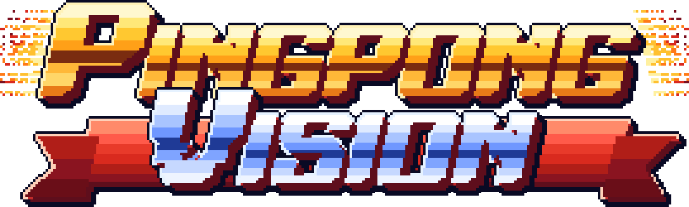

<div align="center">

[English](README.md) · **한국어**

<h1>
  
  
</h1>


<sub>이 움직이는 그림과 화면 캡처: <a href="https://lab.osai.ai/">OpenTTGames 데이터셋</a>(OSAI)의 <code>test_2</code> 프레임을 자르고 줄인 뒤 앱 오버레이를 그린 것입니다. 이 이미지들은 코드의 MIT가 아니라 <a href="https://creativecommons.org/licenses/by-nc-sa/4.0/deed.ko">CC BY-NC-SA 4.0</a>을 따릅니다.</sub>

**무료·오픈소스 탁구 영상 분석. 폰 카메라 한 대로 브라우저에서 돌고, 서버는 내 PC에 직접 띄웁니다.**

[](LICENSE)
[](https://github.com/orientpine/pingpong-vision/releases)
[](https://bun.sh)
[](#pc-설치-tailscale)
[](LICENSE)

</div>

PingPong Vision은 **아이폰 Safari**와 모바일 브라우저에서 도는 **탁구 영상 분석 웹앱**(PWA)입니다. 탁구대 옆 삼각대에 폰을 세우면 화면 위에 바로 이런 것을 보여 줍니다.

- **자세 추정**: 두 선수의 뼈대(MediaPipe Pose Landmarker)
- **공 추적**: 색과 움직임으로 찾고, 머신러닝은 쓰지 않습니다
- **랠리 시간**, **샷 수**, **샷 속도 추정**(km/h)
- **바운드 지도**와 선수가 **서 있는 위치**

분석은 모두 폰 안에서 합니다. 랠리 영상을 내 PC에 저장하는 기능을 직접 켜지 않는 한 카메라 영상은 폰 밖으로 나가지 않습니다. 작은 서버를 내 컴퓨터에 [bun](https://bun.sh)으로 띄우고, 폰에서는 [Tailscale](https://tailscale.com)로 HTTPS 주소를 엽니다. 가입, 구독, 저희 클라우드는 없습니다.

## 목차

- [기능](#기능)
- [화면](#화면)
- [빠른 시작(내 컴퓨터에서 해 보기)](#빠른-시작내-컴퓨터에서-해-보기)
- [PC 설치 (Tailscale)](#pc-설치-tailscale)
- [탁구장에서 쓰는 법](#탁구장에서-쓰는-법)
- [정확도와 한계](#정확도와-한계)
- [선택 기능](#선택-기능)
- [다른 종목으로 바꾸기](#다른-종목으로-바꾸기)
- [기여](#기여)
- [릴리스](#릴리스)
- [라이선스와 제3자 고지](#라이선스와-제3자-고지)

## 기능

| | 내용 |
|---|---|
| 🏓 **실시간 오버레이** | 랠리 시간, 샷 수, 속도 추정, 샷 종류(드라이브·스매시·로빙·푸시, 포핸드·백핸드는 규칙으로 판단), 공 궤적과 믿을 만할 때 뜨는 **LOCK** 상자 |
| 🧍 **선수** | 양쪽 끝 선수의 뼈대, 이동 거리(MOVE), 손목 각도, 탁구대 뒤·옆 어디에 서 있는지 |
| 🗺️ **코트 지도** | 바운드와 선 자리를 위에서 본 탁구대에 표시 |
| 📐 **한 번만 하는 보정** | 탁구대 네 모서리를 한 번 누르면 흰 테두리에 맞춰 주고, 윤곽을 보고 확인 |
| 📱 **폰 중심** | 세로·가로 모두 화면을 꽉 채우고 패널은 위에 뜹니다. 태블릿이나 TV(AirPlay 미러링)에서는 큰 화면 배치 |
| 🎞️ **랠리 기록과 다시 보기** | 랠리마다 시간, 샷 수, 최고 속도, 바운드 지도. 영상은 *내* PC에 추측할 수 없는 공유 링크로 저장(선택) |
| 🛟 **판정 안정 모드** | 폰이 버거우면(같은 프레임 반복, 초당 12장 미만) 분석이 따라가도록 화면을 줄였다가 돌아옵니다 |
| 🔒 **개인정보** | 폰 안에서 분석, 서버는 `127.0.0.1`에만 열림, 켜지 않으면 아무것도 올리지 않음 |
| 🧪 **잴 수 있음** | 공개 [OpenTTGames](https://lab.osai.ai/) 정답으로 공·바운드·샷 검출을 채점하는 오프라인 도구 |

## 화면

아래는 모두 실제 앱이 공개 데이터셋 OpenTTGames 영상으로 계산한 화면입니다. 꾸민 화면이 아닙니다.

| 세로 폰 | 보정(네 번 누르면 테두리에 맞춤) | 랠리 기록 |
|---|---|---|
|  |  |  |


*영상 프레임 출처: OSAI의 OpenTTGames 데이터셋(https://lab.osai.ai/), CC BY-NC-SA 4.0. 바꾼 점: 자르고 줄인 뒤 앱 오버레이를 그림. `docs/img/`의 이미지는 MIT가 아니라 [CC BY-NC-SA 4.0](https://creativecommons.org/licenses/by-nc-sa/4.0/deed.ko)을 따릅니다. 데이터셋 자체는 이 저장소에 들어 있지 않습니다.*

## 빠른 시작(내 컴퓨터에서 해 보기)

[bun](https://bun.sh) 1.1 이상, `git`, `curl`, `unzip`이 필요합니다.

```bash
git clone https://github.com/orientpine/pingpong-vision && cd pingpong-vision
bash install.sh && bun server.js
```

**http://localhost:8791/vision/** 을 엽니다(끝의 `/`까지). 컴퓨터 브라우저는 `localhost`를 안전한 주소로 보므로 카메라도 됩니다. 카메라가 없으면 **영상 파일로 시험**을 누르고 탁구 영상을 고르세요.

`install.sh`는 필요한 도구를 확인하고, `bun install`, 자세 모델 받기(sha256 확인, `public/models/`), 설정 파일 만들기, 시험 실행(`/healthz` 200 확인)을 합니다. 여러 번 돌려도 됩니다. 단위 시험은 `bun test`.

## PC 설치 (Tailscale)

관리자가 동호회에서 쓰는 방식 그대로입니다. 서버는 집이나 탁구장 PC에서 돌고, 폰은 HTTPS로 엽니다. 폰은 HTTPS에서만 카메라를 허락하는데, Tailscale이 내 PC에 진짜 인증서가 붙은 HTTPS 주소를 무료로, 공유기 포트를 열지 않고 만들어 줍니다.

```text
 폰(Safari/Chrome) ──HTTPS──▶ Tailscale ──▶ 내 PC: tailscale serve ──▶ bun server.js (127.0.0.1:8791)
```

**준비물**

- 켜 둘 PC 한 대: 리눅스, 맥, 또는 윈도우 10/11 + [WSL](https://learn.microsoft.com/ko-kr/windows/wsl/install)(Ubuntu)
- 폰: 아이폰 Safari(관리자는 iOS 18에서 씀) 또는 안드로이드 Chrome
- 무료 Tailscale 계정(구글, 마이크로소프트, 깃허브, 애플 계정으로 로그인)
- 삼각대나 폰 거치대(높이 1.5~2 m)

### 1. PC와 폰에 Tailscale

1. PC에 Tailscale 설치: https://tailscale.com/download (리눅스는 `curl -fsSL https://tailscale.com/install.sh | sh` 다음 `sudo tailscale up`)
2. 폰에 Tailscale 앱(App Store, Google Play)을 깔고 **같은 계정**으로 로그인
3. [관리 화면 → DNS](https://login.tailscale.com/admin/dns)에서 **MagicDNS**와 **HTTPS Certificates**를 켭니다. 처음 `tailscale serve`를 할 때도 물어봅니다.
4. 리눅스에서는 sudo 없이 `tailscale serve`를 쓰도록 한 번만:

   ```bash
   sudo tailscale set --operator=$USER
   ```

**윈도우(WSL):** Tailscale은 WSL 안이 아니라 **윈도우**에 설치합니다. 앱은 WSL 안에서 돌고, 윈도우가 `localhost`를 WSL로 넘겨 줍니다.

### 2. bun 설치

```bash
curl -fsSL https://bun.sh/install | bash
```

설치 뒤 터미널을 새로 열어야 `bun`이 잡힙니다(`bun --version`이 1.1 이상). 리눅스/WSL에서는 먼저 `sudo apt install -y git curl unzip`이 필요할 수 있습니다.

### 3. 코드 받고 설치

```bash
git clone https://github.com/orientpine/pingpong-vision
cd pingpong-vision
bash install.sh
```

마지막 줄이 다음에 할 일을 알려 줍니다. 잘 되면 `/healthz 200: the server works.`로 끝납니다.

### 4. 설정 파일

`install.sh`가 [`deploy.env.example`](deploy.env.example)을 복사해 `~/.config/pingpong-vision/deploy.env`를 만듭니다.

```bash
PORT=8791                # PC 안 포트. 서버는 127.0.0.1에만 열립니다
FUNNEL_PORT=443          # Tailscale 주소의 HTTPS 포트(443이면 주소에 포트가 안 붙음)
PPV_TS_MODE=serve        # serve: 내 tailnet 기기만, funnel: 링크를 아는 누구나
PPV_TOURNAMENT_URL=off   # "PIN으로 PC 저장"용 점수판 앱 주소. 이 저장소에 없으니 off
```

Tailscale 없는 친구 폰처럼 tailnet 밖에서 열어야 하는 게 아니면 `serve`를 그대로 두세요. [Funnel](https://tailscale.com/kb/1223/funnel)은 인터넷 전체에 열리고 443, 8443, 10000 포트만 됩니다.

### 5. 실행

**리눅스(systemd):** 명령 하나면 됩니다. 사용자 서비스를 만들어(멈추면 다시 켜지고, 부팅 때도 켜짐) `/healthz`를 기다린 뒤 `tailscale serve`(또는 funnel)까지 걸어 줍니다.

```bash
./start.sh
loginctl enable-linger $USER   # 로그아웃해도 계속 돌게(한 번만)
```

`URL: https://<내 PC의 MagicDNS 이름>:443/vision/`이 찍힙니다(전체 이름은 `tailscale serve status`에 나옴). `./start.sh --restart`는 지금 체크아웃을 배포하고 다시 켭니다. 서비스는 `~/.local/share/pingpong-vision/releases/`의 사본을 돌리므로, 체크아웃을 고쳐도 다시 켜기 전까지는 바뀌지 않습니다.

**맥, WSL, 직접 띄우기:** 서버를 켜고 Tailscale로 한 번만 공유합니다. `--bg` 설정은 재부팅해도 남습니다.

```bash
bun server.js                                                         # 터미널 1(열어 둠)
tailscale serve --bg --https=443 --set-path=/vision http://127.0.0.1:8791/vision   # 터미널 2, 한 번만
tailscale serve status                                                # https:// 주소 확인
```

윈도우에서는 `tailscale serve` 줄을 PowerShell(윈도우용 Tailscale)에서, `bun server.js`는 WSL 안에서 실행합니다.

### 6. 폰에서 열기

1. 폰의 Tailscale이 **연결됨**인지 확인합니다.
2. 5단계 주소 `https://<내 PC의 MagicDNS 이름>/vision/`을 엽니다.
3. 처음 한 번 약 20 MB(자세 모델과 실행 파일)를 받습니다. 로딩 막대는 실제로 받은 양을 세고, 다음부터는 캐시를 씁니다.
4. 홈 화면에 추가하면 앱처럼 전체 화면으로 열립니다. **Safari**: 공유 → *홈 화면에 추가*. **Chrome**: ⋮ → *홈 화면에 추가* 또는 *앱 설치*.
5. **카메라 시작**을 누르고 카메라를 허용합니다.

### 7. 자동 시작(맥)

리눅스는 `start.sh`가 해 줍니다. 맥은 LaunchAgent로 `bun server.js`를 켜 둡니다. 아래를 `~/Library/LaunchAgents/local.pingpong-vision.plist`로 저장하세요(경로 두 곳은 내 것으로).

```xml
<?xml version="1.0" encoding="UTF-8"?>
<!DOCTYPE plist PUBLIC "-//Apple//DTD PLIST 1.0//EN" "http://www.apple.com/DTDs/PropertyList-1.0.dtd">
<plist version="1.0"><dict>
  <key>Label</key><string>local.pingpong-vision</string>
  <key>WorkingDirectory</key><string>/Users/YOU/pingpong-vision</string>
  <key>ProgramArguments</key><array><string>/Users/YOU/.bun/bin/bun</string><string>server.js</string></array>
  <key>EnvironmentVariables</key><dict><key>PORT</key><string>8791</string></dict>
  <key>RunAtLoad</key><true/>
  <key>KeepAlive</key><true/>
</dict></plist>
```

```bash
launchctl load -w ~/Library/LaunchAgents/local.pingpong-vision.plist
```

### 8. 업데이트

```bash
cd pingpong-vision && git pull && bash install.sh
./start.sh --restart        # 리눅스 서비스. 맥이나 직접 띄운 경우는 bun server.js를 다시 켭니다
```

바뀐 점은 [릴리스](https://github.com/orientpine/pingpong-vision/releases)에서 봅니다.

### 9. 문제 해결

| 증상 | 해결 |
|---|---|
| 카메라 버튼이 안 되거나 권한 거부 | 주소가 `https://`(또는 `localhost`)여야 합니다. 아이폰: 설정 → Safari → 카메라 → *묻기* 또는 *허용* 후 새로고침. 카메라를 쓰는 다른 앱을 닫으세요. |
| `http://<PC 내부 IP>:8791`이 안 열림 | 일부러 그렇습니다. 서버는 `127.0.0.1`에만 열립니다. Tailscale `https://` 주소를 쓰세요. |
| 폰에서 Tailscale `https://` 주소가 안 열림 | 폰 Tailscale이 같은 계정으로 연결돼 있어야 합니다. PC에서 `tailscale serve status`로 확인하고, 관리 화면에서 HTTPS Certificates가 켜졌는지 보세요. 첫 인증서는 1분쯤 걸릴 수 있습니다. |
| `tailscale serve`가 *access denied* | `sudo tailscale set --operator=$USER`를 한 번 하거나 앞에 `sudo`를 붙입니다. |
| Funnel이 안 켜져 있다고 함 | tailnet 정책을 바꿔야 합니다. 찍힌 링크를 따라가거나 `PPV_TS_MODE=serve`를 쓰세요. |
| 방화벽 | 열 것이 없습니다. Tailscale이 직접 연결을 만들고, 앱은 들어오는 포트가 필요 없습니다. |
| `install.sh`나 `start.sh`가 8791 포트가 쓰인다고 함 | 리눅스 `ss -ltnp \| grep 8791`, 맥 `lsof -i :8791`로 누가 쓰는지 봅니다. `deploy.env`의 `PORT`를 바꾸고 `bash install.sh`를 다시 돌린 뒤, `tailscale serve` 명령에도 새 포트를 씁니다. |
| `start.sh`가 *set PPV_TOURNAMENT_URL* 또는 *set FUNNEL_PORT*로 멈춤 | `deploy.env`에 그 줄이 없습니다. `deploy.env.example`에서 복사하세요. |
| 로딩 막대가 멈춤 | 이유와 **다시 받기**가 뜹니다. 모델은 내 PC가 보내 주므로(`install.sh`에서 받아 둠) PC가 켜져 있는지 확인하세요. |
| `bun: command not found` | bun 설치 뒤 터미널을 새로 열거나 `~/.bun/bin/bun`으로 실행합니다. |
| 서비스 로그(리눅스) | `journalctl --user -u pingpong-vision -n 50` |

## 탁구장에서 쓰는 법

1. **폰 놓기**: 네트 연장선 위, 탁구대 옆면에서 2~3 m, 높이 1.5~2 m에서 살짝 내려다보게 삼각대에 세워 탁구대 전체와 두 선수가 다 들어오게 합니다. 수평을 맞추세요. 카메라가 탁구대 높이에 있으면 탁구대 윗면이 선처럼 보여 바운드와 속도를 계산할 수 없습니다. 자세한 위치: [docs/system-design.md](docs/system-design.md).
2. **카메라 시작**을 누릅니다. 녹화한 영상으로 해 보려면 **영상 파일로 시험**.
3. **코트 보정**을 한 번 합니다. 화면 안내 순서대로 네 모서리를 누릅니다: ① 내 쪽 왼쪽, ② 내 쪽 오른쪽, ③ 건너편 오른쪽, ④ 건너편 왼쪽. 누른 점이 흰 테두리에 맞춰지고, 점을 끌어 고친 뒤 **확인**. 삼각대가 그대로면 보정도 그대로입니다. 보정 전이거나 네 점 안이 탁구대 윗면처럼 보이지 않으면 공을 찾지 않고, 폰이 흔들리는 동안에도 쉽니다.
4. 두 끝은 **레드 사이드 / 블루 사이드**입니다. 선수가 엔드를 바꾸면 **자리 교체**. 왼손잡이는 **설정**에서 라켓 손을 바꾸면 포핸드·백핸드 판정에 씁니다.
5. 경기합니다. 끝나면 **정지**, **기록**에서 랠리마다 시간, 샷 수, 최고 속도, 바운드 지도를 봅니다.
6. 아이패드 가로나 TV 미러링이면 큰 화면 배치가 됩니다. 설정에서 직접 고를 수도 있습니다.

## 정확도와 한계

이번 릴리스 코드로 OpenTTGames `test_2`(1080p, 120 fps 원본, 30초)를 리눅스 PC에서 60 fps로 처리해 아래 명령으로 잰 값입니다. **아이폰에서 잰 값이 아닙니다.**

| 지표(`test_2`) | 결과 |
|---|---|
| 공 재현율 / 정밀도(20 px 안, 정답이 있는 프레임, n = 387) | 86.6% / 96.5% |
| 바운드 F1(정답 바운드 28개) | 83.3%(정답에서 빠진 바운드를 맞은 것으로 치면 정밀도 96.9%) |
| 바운드 사이 샷 수가 맞은 구간 | 15 / 16 |

재현: https://lab.osai.ai/datasets/openttgames/data/ 에서 `test_2.mp4`와 `test_2.zip`을 `data/videos/`(git에서 제외됨)에 받고, 정답을 `data/videos/test_2/`에 푼 뒤:

```bash
bun qa/ball-offline.mjs --video=data/videos/test_2.mp4 \
  --corners='[{"x":355,"y":634},{"x":557,"y":519},{"x":1339,"y":535},{"x":1486,"y":659}]' \
  --out=/tmp/test_2.offline.json
bun qa/score.mjs /tmp/test_2.offline.json data/videos/test_2 /tmp/test_2.score.json
```

**한계**(숫자를 믿기 전에 꼭 읽어 주세요)

- **속도와 거리는 카메라 한 대로 낸 추정치입니다.** 공 높이를 모르므로 위치를 탁구대 가운데 선에 투영하고 탁구대 길이(2.74 m)로 환산합니다. 옆에서 찍을 때 가장 잘 맞습니다.
- **공 검출은 색과 움직임 기반**이고 흰 공에 맞췄습니다(주황은 실험). 흰 옷, 흰 벽, 어두운 체육관에서는 놓치거나 잘못 잡습니다.
- **프레임 수.** Safari는 60 fps를 요청하지만 어두우면 30 fps로 떨어지고, 빠른 공은 바운드를 건너뛸 수 있습니다. 보정할 때 어둡다고 알려 줍니다.
- **샷 종류는 규칙**입니다(모델 아님). 포핸드·백핸드는 손목이 몸 어느 쪽에 있는지, 드라이브·스매시·로빙·푸시는 속도와 궤적으로 정합니다. 회전은 모릅니다.
- **선수는 양 끝에 한 명씩 두 명만.** 복식이나 지나가는 사람은 처리하지 않습니다.
- **폰마다 속도가 다릅니다.** `/vision/bench.html`이 내 폰의 자세 추정 속도를 잽니다. 두 선수가 나온 1280x720 정지 화면 `public/bench/frame.jpg`가 필요합니다(포함 안 됨). 예: `ffmpeg -ss 0.9 -i data/videos/test_2.mp4 -frames:v 1 -vf scale=1280:720 -q:v 3 public/bench/frame.jpg`

## 선택 기능

- **내 PC에 랠리 저장.** 끝난 랠리의 기록과 영상을 내 PC의 `save-server.js`로 보냅니다(폴더 권한 `0700`, 크기·개수 상한). 랠리마다 길고 추측할 수 없는 공유 링크와 지우기 버튼이 생깁니다. 업로드 열쇠는 1회용 설정 링크로 폰에 넘깁니다. 자세한 것은 [docs/save-to-pc.md](docs/save-to-pc.md). `~/.config/pingpong-vision/`의 열쇠는 절대 커밋하지 마세요.
- **점수판 연동.** `public/js/point.js`가 바운드 순서(두 번 바운드, 아웃, 놓침)로 포인트 승패를 판정하고, `public/js/tournament.js`가 같은 주소 `/`의 점수판 앱에 넣습니다. 3초 취소, 한국어 점수 음성, 렛?/폴트? 한 번 눌러 확정이 있습니다. **점수판 앱은 이 저장소에 없습니다.** 점수판이 갖춰야 할 API는 [docs/tournament-link.md](docs/tournament-link.md)에 있습니다. 점수판이 없어도 나머지는 모두 혼자 됩니다.

`server.js` 환경 변수:

| 변수 | 기본값 | 하는 일 |
|---|---|---|
| `PORT` | `8791` | 포트(늘 `127.0.0.1`에만 열림) |
| `PPV_QA` | 없음 | `1`이면 `qa/` 페이지도 보냄 |
| `PPV_SAVE_DIR` | `~/pingpong-vision-saves` | 저장한 랠리 폴더 |
| `PPV_KEY_FILE` | `~/.config/pingpong-vision/upload-key` | 업로드 열쇠 파일(처음 켤 때 만듦) |
| `PPV_SETUP_FILE` | `~/.config/pingpong-vision/setup-tokens.json` | 1회용 설정 링크 토큰 |
| `PPV_TOURNAMENT_URL` | 없음 | PC 저장 PIN을 확인할 점수판 앱. 없으면 그 기능은 꺼짐 |

## 다른 종목으로 바꾸기

탁구에만 해당하는 부분은 몇 개 모듈에 모여 있습니다.

| 무엇 | 어디 | 바꿀 것 |
|---|---|---|
| 코트 크기 | `public/js/geom.js`: `TABLE_LENGTH`(2.74), `TABLE_WIDTH`(1.525), `TABLE_HEIGHT`(0.76), `makeCalibration` | 미터 단위 크기. 코트 종목은 선수가 코트 면에 서므로 `TABLE_HEIGHT` 바닥 차이는 0 |
| 중복 상수 | `public/js/ui.js`: `TABLE_L`, `TABLE_W`, `MOVE_SCALE_M`, `SHOT_SCALE_KMH` | 바운드 지도 모양과 막대 눈금 |
| 선수 구역 | `public/js/players.js`: `ZONE_M`, `plausiblePerson` | 테니스 선수는 코트 밖 멀리까지 가니 구역을 넓힘 |
| 공 모양 | `public/js/ball.js`: `BallDetector`, `BallTracker`, `pathResidual` | 색, 밝기, 크기, 속도 조건(테니스공은 연두색이고 더 큼) |
| 장면 조건 | `public/js/pipeline.js`: `tableUniformity`, `TABLE_MIN_UNIFORM`, `TABLE_CHECK_EVERY`, `SHAKE_*`, `ISSUE_NO_TABLE` | "한 색 탁구대 윗면" 검사는 작은 단색 면을 가정 |
| 바운드·샷·랠리 끝 | `public/js/rally.js`: `RallyEngine` | 바운드 검출, 샷 추론, 랠리 끝 시간, 네트 위치(`TABLE_LENGTH / 2`) |
| 포인트 승패 | `public/js/point.js`(+ `test/point.test.js`, `qa/point-eval.mjs`) | 새 규칙(선 안/밖, 서비스 박스, 한 번 바운드 허용)으로 다시 작성 |
| 샷 이름 | `public/js/rally.js`: `classifyKind`(45/35/22 km/h), `strokeSide` | 새 기술 이름과 기준 |
| 보정 화면 | `public/js/ui.js`: `CALIB_STEPS`, `CALIB_DONE` | 탁구대 모서리 대신 코트 선 모서리 |
| 화면 글자 | `public/js/hud.js`(`drawHud`), `public/js/ui.js`, `pipeline.js`의 문구 | 이름과 안내 문구 |
| 시험과 측정 도구 | `test/*.test.js`, `qa/ball-offline.mjs`, `qa/score.mjs` | 고정 데이터, 기댓값, 내 정답 영상 |

## 기여

이슈와 PR 모두 환영합니다(한국어, 영어 모두 좋습니다).

- PR 전에 `bun test`를 돌려 주세요. 화면을 바꿨다면 폰(가로 393 px)과 가로 화면 캡처를 붙여 주세요.
- 카메라 영상, 공개 데이터가 아닌 사람 프레임, 열쇠, 호스트 이름, 주소는 **절대 커밋하지 마세요.** 올리기 전에 확인:

  ```bash
  R=$(mktemp -d) && git archive HEAD | tar -x -C "$R" && bash scripts/scan-public.sh "$R"; rm -rf "$R"
  ```

- 구조와 데이터 약속: [docs/system-design.md](docs/system-design.md), [docs/contract.md](docs/contract.md), 화면 규칙 [docs/ui-guidelines.md](docs/ui-guidelines.md).

## 릴리스

버전은 [유의적 버전](https://semver.org/lang/ko/)을 따릅니다. 버전마다 바뀐 점은 [CHANGELOG.ko.md](CHANGELOG.ko.md)(English [CHANGELOG.md](CHANGELOG.md))에 쉬운 말로 적습니다. 내려받기(소스 zip)는 [릴리스](https://github.com/orientpine/pingpong-vision/releases) 페이지에 있습니다. 릴리스를 만드는 방법은 [RELEASING.md](RELEASING.md)에 있습니다.

## 라이선스와 제3자 고지

MIT © orientpine, [LICENSE](LICENSE). 상업적 용도를 포함해 무료로 쓰고 고치고 나눌 수 있습니다. 저작권 표시는 남겨 주세요.

제3자 구성 요소(자세한 것은 [THIRD_PARTY_NOTICES.md](THIRD_PARTY_NOTICES.md)):

- Galmuri 픽셀 폰트, SIL OFL 1.1 (`public/fonts/LICENSE-Galmuri-OFL.txt`)
- MediaPipe Tasks Vision과 Pose Landmarker 모델, Apache-2.0
- ONNX Runtime Web, MIT. RTMPose 모델(OpenMMLab), Apache-2.0(성능 측정 페이지에서만 사용)
- OpenTTGames 데이터는 들어 있지 않습니다. `docs/img/`의 이미지(배너 GIF, 화면 캡처, social preview)는 그 데이터의 프레임을 담고 있어 MIT가 아니라 [CC BY-NC-SA 4.0](https://creativecommons.org/licenses/by-nc-sa/4.0/deed.ko)을 따릅니다(출처: OpenTTGames, OSAI, https://lab.osai.ai/).
