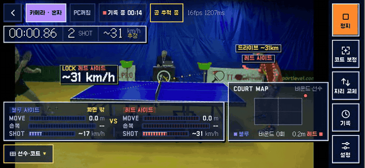
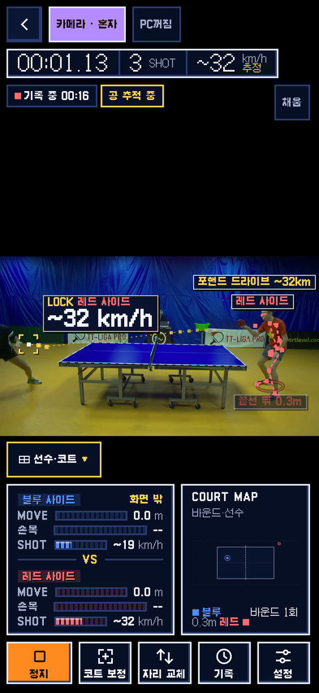
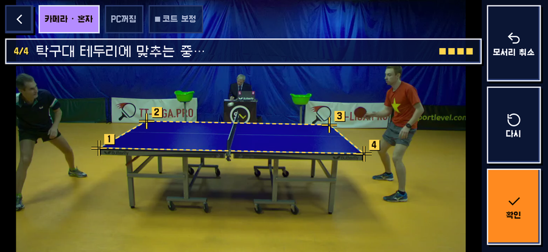
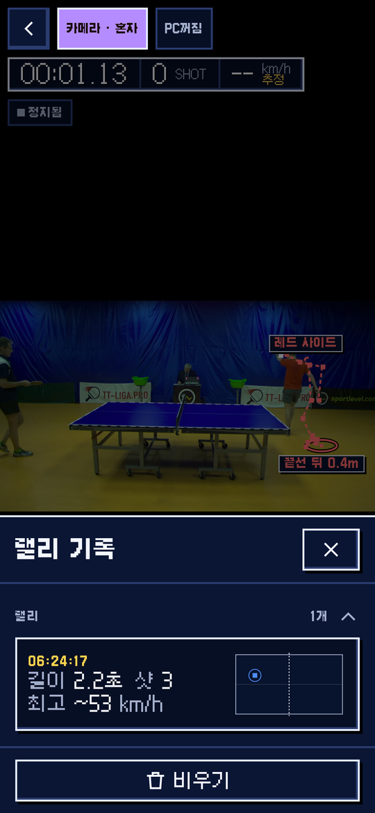
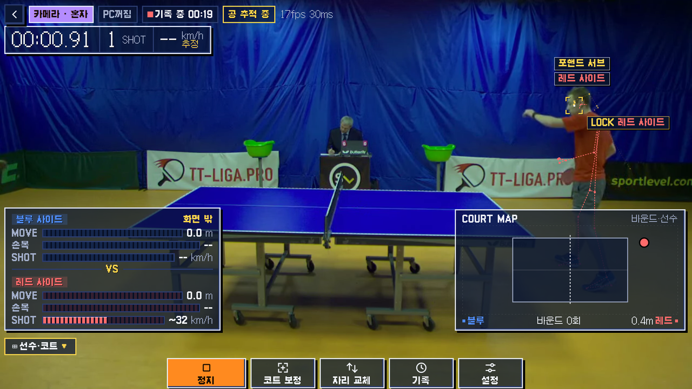

<div align="center">

**English** · [한국어](README.ko.md)



<sub>Banner and screenshots: frames of <code>test_2</code> from the <a href="https://lab.osai.ai/">OpenTTGames dataset</a> (OSAI), cropped and scaled, with the app's overlay drawn on top. These images are licensed under <a href="https://creativecommons.org/licenses/by-nc-sa/4.0/">CC BY-NC-SA 4.0</a>, not under the MIT license of the code.</sub>

# Table Tennis Vision

**Free, open-source table tennis (ping-pong) video analysis from one phone camera. It runs in the browser on your phone, and you host it yourself.**

[](LICENSE)
[](https://github.com/orientpine/table-tennis-vision/releases)
[](https://bun.sh)
[](#install-on-your-pc-with-tailscale)
[](LICENSE)

</div>

Table Tennis Vision is a **table tennis analysis web app** (a PWA) for **iPhone Safari** and other mobile browsers. Put the phone on a tripod beside the table and it shows, live on the picture:

- **pose estimation** (skeletons for two players, MediaPipe Pose Landmarker)
- **ball tracking** (colour and motion, no ML)
- **rally time**, **shot count** and an **estimated shot speed** in km/h
- a **bounce map** and each player's **standing position**

All the computer vision runs on the phone. The camera stream never leaves it unless you turn on saving rally clips to your own PC. You run the small server on your own computer with [bun](https://bun.sh) and open it on your phone over HTTPS through [Tailscale](https://tailscale.com). There is no account, no subscription, and no cloud service of ours.

> The app's screens are in Korean (it was built for a Korean table tennis club). This README explains every button in English.

## Contents

- [Features](#features)
- [Screenshots](#screenshots)
- [Quick start (try it on your computer)](#quick-start-try-it-on-your-computer)
- [Install on your PC with Tailscale](#install-on-your-pc-with-tailscale)
- [Using it at the table](#using-it-at-the-table)
- [Accuracy and limits](#accuracy-and-limits)
- [Optional extras](#optional-extras)
- [Adapting to another sport](#adapting-to-another-sport)
- [Contributing](#contributing)
- [Releases](#releases)
- [License and third-party notices](#license-and-third-party-notices)

## Features

| | What you get |
|---|---|
| 🏓 **Live overlay** | Rally timer, shot count, estimated speed, shot type (drive / smash / lob / push, forehand / backhand by rule), ball trail with a **LOCK** box when the ball track is trusted |
| 🧍 **Players** | Skeletons for the player at each end, MOVE distance, wrist angle, standing position behind or beside the table |
| 🗺️ **Court map** | Bounces and standing positions on a top view of the table |
| 📐 **One-time calibration** | Tap the four table corners once. The taps snap onto the white border and you confirm the outline |
| 📱 **Phone first** | Portrait or landscape, full-screen picture with floating panels. Works on a tablet or a TV (AirPlay mirroring) as a big-screen layout |
| 🎞️ **Rally history and replays** | Each rally's time, shots, top speed and bounce map. Clips can be saved to *your* PC with an unguessable share link (optional) |
| 🛟 **Stable judging mode** | If the phone falls behind (repeated frames or under 12 reads per second), the picture shrinks so the analysis keeps up, then comes back |
| 🔒 **Private by design** | On-device analysis, the server binds to `127.0.0.1` only, nothing is uploaded unless you turn it on |
| 🧪 **Measurable** | Offline harness that scores ball, bounce and shot detection against the public [OpenTTGames](https://lab.osai.ai/) annotations |

## Screenshots

All screenshots are the real app computing on a clip from the public OpenTTGames dataset. They are not mock-ups.

| Portrait phone | Calibration (4 taps, snapped to the border) | Rally history |
|---|---|---|
|  |  |  |



*Frames from the OpenTTGames dataset by OSAI (https://lab.osai.ai/), CC BY-NC-SA 4.0, changed: cropped, scaled, app overlay added. The images in `docs/img/` are under [CC BY-NC-SA 4.0](https://creativecommons.org/licenses/by-nc-sa/4.0/), not MIT. The dataset itself is not included in this repository.*

## Quick start (try it on your computer)

You need [bun](https://bun.sh) 1.1 or newer, `git`, `curl` and `unzip`.

```bash
git clone https://github.com/orientpine/table-tennis-vision && cd table-tennis-vision
bash install.sh && bun server.js
```

Open **http://localhost:8791/vision/** (keep the trailing slash). Desktop browsers treat `localhost` as secure, so the camera works there. No camera? Tap **영상 파일로 시험** (*Test with a video file*) and pick any table tennis video.

`install.sh` checks your tools, runs `bun install`, downloads the pose models (sha256-checked) into `public/models/`, writes your settings file and does a test run (`/healthz` must answer 200). It is safe to run again. `bun test` runs the unit tests.

## Install on your PC with Tailscale

This is how the maintainer runs it at the club: the server stays on a PC at home or at the venue, and phones open it over HTTPS. A phone only allows camera access on HTTPS, and Tailscale gives your PC an HTTPS address with a real certificate, for free and without opening any port on your router.

```text
 phone (Safari/Chrome) ──HTTPS──▶ Tailscale ──▶ your PC: tailscale serve ──▶ bun server.js (127.0.0.1:8791)
```

**What you need**

- A PC that stays on: Linux, macOS, or Windows 10/11 with [WSL](https://learn.microsoft.com/windows/wsl/install) (Ubuntu)
- A phone: iPhone with Safari (the maintainer uses iOS 18) or Android with Chrome
- A free Tailscale account (sign in with Google, Microsoft, GitHub or Apple)
- A tripod or phone stand, about 1.5 to 2 m high

### 1. Tailscale on the PC and the phone

1. Install Tailscale on the PC: https://tailscale.com/download (on Linux: `curl -fsSL https://tailscale.com/install.sh | sh`, then `sudo tailscale up`).
2. Install the Tailscale app on the phone (App Store or Google Play) and sign in with **the same account**.
3. In the [admin console → DNS](https://login.tailscale.com/admin/dns), turn on **MagicDNS** and **HTTPS Certificates**. `tailscale serve` will also ask for this the first time.
4. On Linux, let your user run `tailscale serve` without sudo (once):

   ```bash
   sudo tailscale set --operator=$USER
   ```

**Windows (WSL):** install Tailscale on **Windows**, not inside WSL. The app runs inside WSL and Windows forwards `localhost` to it.

### 2. bun

```bash
curl -fsSL https://bun.sh/install | bash
```

Open a new terminal afterwards so `bun` is on your `PATH` (`bun --version` should print 1.1 or newer). On Linux/WSL you may need `sudo apt install -y git curl unzip` first.

### 3. Get the code and install

```bash
git clone https://github.com/orientpine/table-tennis-vision
cd table-tennis-vision
bash install.sh
```

The last lines tell you what to do next. A good run ends with `/healthz 200: the server works.`

### 4. Settings

`install.sh` created `~/.config/pingpong-vision/deploy.env` from [`deploy.env.example`](deploy.env.example):

```bash
PORT=8791                # local port; the server listens on 127.0.0.1 only
FUNNEL_PORT=443          # HTTPS port on your Tailscale name (443 = no port in the address)
PPV_TS_MODE=serve        # serve: only your tailnet's devices; funnel: anyone with the link
PPV_TOURNAMENT_URL=off   # scoreboard app for "PC save by PIN"; keep off (not in this repo)
```

Keep `serve` unless people outside your tailnet (for example a friend's phone without Tailscale) must open it. [Funnel](https://tailscale.com/kb/1223/funnel) puts it on the public internet and allows only ports 443, 8443 and 10000.

### 5. Start it

**Linux (systemd):** one command. It starts a user service that restarts on failure and on boot, waits for `/healthz`, and sets up `tailscale serve` (or funnel):

```bash
./start.sh
loginctl enable-linger $USER   # keep it running when you are logged out (once)
```

It prints `URL: https://<your PC's MagicDNS name>:443/vision/` (the full name `tailscale serve status` shows). `./start.sh --restart` deploys the current checkout and restarts. The service runs a copy under `~/.local/share/pingpong-vision/releases/`, so editing the checkout changes nothing until you restart.

**macOS, WSL, or by hand:** start the server, then share it once with Tailscale. The `--bg` setting is remembered across reboots.

```bash
bun server.js                                                         # terminal 1 (keep open)
tailscale serve --bg --https=443 --set-path=/vision http://127.0.0.1:8791/vision   # terminal 2, once
tailscale serve status                                                # shows your https:// address
```

On Windows run the `tailscale serve` line in PowerShell (Tailscale for Windows), and `bun server.js` inside WSL.

### 6. Open it on the phone

1. Make sure Tailscale is **connected** on the phone.
2. Open `https://<your PC's MagicDNS name>/vision/` (the address from step 5).
3. The first visit downloads about 20 MB (pose model and runtime). The loading bar counts the real bytes, and later visits use the cache.
4. Add it to the home screen so it opens full screen like an app: **Safari** → Share → *Add to Home Screen*. **Chrome** → ⋮ → *Add to Home screen* / *Install app*.
5. Tap **카메라 시작** (*Start camera*) and allow the camera.

### 7. Start automatically (macOS)

`start.sh` covers Linux. On macOS, a LaunchAgent keeps `bun server.js` running. Save this as `~/Library/LaunchAgents/local.table-tennis-vision.plist` (fix the two paths):

```xml
<?xml version="1.0" encoding="UTF-8"?>
<!DOCTYPE plist PUBLIC "-//Apple//DTD PLIST 1.0//EN" "http://www.apple.com/DTDs/PropertyList-1.0.dtd">
<plist version="1.0"><dict>
  <key>Label</key><string>local.table-tennis-vision</string>
  <key>WorkingDirectory</key><string>/Users/YOU/table-tennis-vision</string>
  <key>ProgramArguments</key><array><string>/Users/YOU/.bun/bin/bun</string><string>server.js</string></array>
  <key>EnvironmentVariables</key><dict><key>PORT</key><string>8791</string></dict>
  <key>RunAtLoad</key><true/>
  <key>KeepAlive</key><true/>
</dict></plist>
```

```bash
launchctl load -w ~/Library/LaunchAgents/local.table-tennis-vision.plist
```

### 8. Update

```bash
cd table-tennis-vision && git pull && bash install.sh
./start.sh --restart        # Linux service; on macOS/by hand restart bun server.js instead
```

Check [Releases](https://github.com/orientpine/table-tennis-vision/releases) for what changed.

### 9. Troubleshooting

| Problem | Fix |
|---|---|
| The camera button does nothing or says permission denied | The page must be `https://` (or `localhost`). On iPhone: Settings → Safari → Camera → *Ask* or *Allow*, then reload. Close other apps using the camera. |
| `http://<PC's LAN IP>:8791` does not open | By design: the server only listens on `127.0.0.1`. Use the Tailscale `https://` address. |
| The Tailscale `https://` address does not load on the phone | Tailscale must be connected on the phone with the same account. Run `tailscale serve status` on the PC and check that HTTPS Certificates is on in the admin console. The first certificate can take a minute. |
| `tailscale serve` says *access denied* | Run `sudo tailscale set --operator=$USER` once, or put `sudo` in front. |
| Funnel says it is not enabled | Funnel needs a tailnet policy change: follow the link it prints, or use `PPV_TS_MODE=serve`. |
| Firewall | Nothing to open. Tailscale makes its own connection, and the app needs no inbound port. |
| `install.sh` or `start.sh` says port 8791 is in use | Find it with `ss -ltnp \| grep 8791` (Linux) or `lsof -i :8791` (macOS). Set another `PORT` in `deploy.env`, run `bash install.sh` again, and use the new port in the `tailscale serve` command. |
| `start.sh` stops with *set PPV_TOURNAMENT_URL* or *set FUNNEL_PORT* | Your `deploy.env` is missing that line. Copy it from `deploy.env.example`. |
| The loading bar stops | The reason and **다시 받기** (*download again*) appear. Check the PC is online: the models are served by your PC, and the PC downloaded them in `install.sh`. |
| `bun: command not found` | Open a new terminal after installing bun, or run `~/.bun/bin/bun`. |
| Service logs (Linux) | `journalctl --user -u pingpong-vision -n 50` |

## Using it at the table

1. **Place the phone** on a tripod in line with the net, 2 to 3 m from the side of the table, 1.5 to 2 m high, looking slightly down, so the whole table and both players are in the picture. Keep it level. If the camera sits at table height, the table top becomes a line and bounces and speed cannot be computed. Placement details: [docs/system-design.md](docs/system-design.md).
2. Tap **카메라 시작** (*Start camera*), or **영상 파일로 시험** (*Test with a video file*) to try a recording.
3. **Calibrate once** with **코트 보정** (*court calibration*). Tap the four table corners in the order shown: (1) your end, left; (2) your end, right; (3) far end, right; (4) far end, left. The taps snap to the white border. Drag a point to fix it, then **확인** (*Confirm*). Calibration stays as long as the tripod does not move. Until it is done, or when the four points do not enclose a table top, the app does not look for the ball. It also pauses while the phone shakes.
4. The two ends are **레드 사이드 / 블루 사이드** (red / blue side). If the players change ends, tap **자리 교체** (*swap places*). Set a left-handed player's racket hand in **설정** (*Settings*). It decides forehand or backhand.
5. Play. Tap **정지** (*Stop*) when done, and open **기록** (*History*) for each rally's time, shot count, top speed and bounce map.
6. On an iPad in landscape, or a phone mirrored to a TV, the app switches to the big-screen layout. You can pick it in Settings.

## Accuracy and limits

Measured with this release's code on OpenTTGames `test_2` (1080p, 120 fps source, 30 s), processed at 60 fps on a Linux PC with the command below. **This is not a measurement on an iPhone.**

| Metric (`test_2`) | Result |
|---|---|
| Ball recall / precision (within 20 px, on annotated frames, n = 387) | 86.6% / 96.5% |
| Bounce F1 (28 annotated bounces) | 83.3% (precision 96.9% when counting bounces the annotation skips) |
| Bounce intervals with the right shot count | 15 / 16 |

Reproduce it: download `test_2.mp4` and `test_2.zip` from https://lab.osai.ai/datasets/openttgames/data/ into `data/videos/` (gitignored), unzip the markup to `data/videos/test_2/`, then run:

```bash
bun qa/ball-offline.mjs --video=data/videos/test_2.mp4 \
  --corners='[{"x":355,"y":634},{"x":557,"y":519},{"x":1339,"y":535},{"x":1486,"y":659}]' \
  --out=/tmp/test_2.offline.json
bun qa/score.mjs /tmp/test_2.offline.json data/videos/test_2 /tmp/test_2.score.json
```

**Limits** (please read before you rely on the numbers):

- **Speed and distance are estimates from one camera.** Ball height is unknown, so positions are projected onto the table's centre line and scaled by the table length (2.74 m). A side view works best.
- **The ball detector uses colour and motion**, tuned for a white ball (orange is experimental). White clothes, white walls and dark halls cause misses and false hits.
- **Frame rate.** Safari asks for 60 fps and may drop to 30 fps in low light, where a fast ball can skip a bounce. The app warns about low light at calibration.
- **Shot type is a rule**, not a model: forehand or backhand from which side of the body the wrist is on, drive / smash / lob / push from speed and arc. No spin.
- **Two players only**, one at each end. Doubles and people walking past are not handled.
- **The phone's speed varies.** `/vision/bench.html` measures pose speed on your phone. It needs one 1280x720 still with two players at `public/bench/frame.jpg` (not included), for example `ffmpeg -ss 0.9 -i data/videos/test_2.mp4 -frames:v 1 -vf scale=1280:720 -q:v 3 public/bench/frame.jpg`.

## Optional extras

- **Save rallies to your PC.** Each finished rally's record and clip go to `save-server.js` on your PC (the folder is `0700`, with size and count caps). The rally gets a long, unguessable share link and a delete button. A one-time setup link hands the upload key to a phone. See [docs/save-to-pc.md](docs/save-to-pc.md). Never commit the key under `~/.config/pingpong-vision/`.
- **Scoreboard link.** `public/js/point.js` judges who won each point from the bounce order (double bounce, out, miss). `public/js/tournament.js` can enter it into a scoreboard app served at `/` of the same origin, with a 3 s cancel bar, Korean score call-outs and one-tap let / fault prompts. **The scoreboard app is not part of this repository.** [docs/tournament-link.md](docs/tournament-link.md) describes the API it has to provide. Without one, everything else works on its own.

Environment variables of `server.js`:

| Variable | Default | What it does |
|---|---|---|
| `PORT` | `8791` | Port, always bound to `127.0.0.1` |
| `PPV_QA` | unset | `1` also serves the `qa/` pages |
| `PPV_SAVE_DIR` | `~/pingpong-vision-saves` | Where saved rallies go |
| `PPV_KEY_FILE` | `~/.config/pingpong-vision/upload-key` | Upload key file (created on first start) |
| `PPV_SETUP_FILE` | `~/.config/pingpong-vision/setup-tokens.json` | One-time setup link tokens |
| `PPV_TOURNAMENT_URL` | unset | Scoreboard app that checks the PIN for PC save. Unset means that feature is off |

## Adapting to another sport

Everything specific to table tennis lives in a handful of modules:

| Concern | Where | What to change |
|---|---|---|
| Court geometry | `public/js/geom.js`: `TABLE_LENGTH` (2.74), `TABLE_WIDTH` (1.525), `TABLE_HEIGHT` (0.76), `makeCalibration` | Court size in metres. On a court the players stand on the court plane, so the `TABLE_HEIGHT` floor drop becomes 0 |
| Duplicated constants | `public/js/ui.js`: `TABLE_L`, `TABLE_W`, `MOVE_SCALE_M`, `SHOT_SCALE_KMH` | Bounce-map shape and meter scales |
| Player zone | `public/js/players.js`: `ZONE_M`, `plausiblePerson` | Players can stand far outside a tennis court, so widen the zone |
| Ball appearance | `public/js/ball.js`: `BallDetector`, `BallTracker`, `pathResidual` | Colour, brightness, size and speed gates (a tennis ball is yellow-green and bigger) |
| Scene gates | `public/js/pipeline.js`: `tableUniformity`, `TABLE_MIN_UNIFORM`, `TABLE_CHECK_EVERY`, `SHAKE_*`, `ISSUE_NO_TABLE` | The "uniform table top" check assumes a small single-colour surface |
| Bounces, shots, rally end | `public/js/rally.js`: `RallyEngine` | Bounce detection, shot inference, rally timeout, net at `TABLE_LENGTH / 2` |
| Point winner | `public/js/point.js` (+ `test/point.test.js`, `qa/point-eval.mjs`) | Rewrite for the new rules (in/out by lines, service boxes, one bounce allowed) |
| Shot labels | `public/js/rally.js`: `classifyKind` (45 / 35 / 22 km/h), `strokeSide` | New strokes and thresholds |
| Calibration UI | `public/js/ui.js`: `CALIB_STEPS`, `CALIB_DONE` | Tap court-line corners instead of table corners |
| HUD text | `public/js/hud.js` (`drawHud`), `public/js/ui.js`, strings in `pipeline.js` | Labels and messages (Korean today) |
| Tests and harness | `test/*.test.js`, `qa/ball-offline.mjs`, `qa/score.mjs` | Fixtures, expected values, your own annotated clips |

## Contributing

Issues and pull requests are welcome, in English or Korean.

- Run `bun test` before you open a PR. For UI changes, add a screenshot of the phone (393 px wide) and a landscape view.
- **Never commit** camera recordings, frames of people (except public datasets), keys, host names or addresses. Check what you are about to push:

  ```bash
  R=$(mktemp -d) && git archive HEAD | tar -x -C "$R" && bash scripts/scan-public.sh "$R"; rm -rf "$R"
  ```

- Architecture and data contracts: [docs/system-design.md](docs/system-design.md), [docs/contract.md](docs/contract.md), UI rules in [docs/ui-guidelines.md](docs/ui-guidelines.md).

## Releases

Versions follow [semantic versioning](https://semver.org/). [CHANGELOG.md](CHANGELOG.md) (한국어 [CHANGELOG.ko.md](CHANGELOG.ko.md)) lists what changed in each version, in plain words. Downloads (source zip) are on the [Releases](https://github.com/orientpine/table-tennis-vision/releases) page. [RELEASING.md](RELEASING.md) describes how a release is made.

## License and third-party notices

MIT © orientpine, see [LICENSE](LICENSE). Free to use, change and share, also commercially. Keep the copyright notice.

Third-party parts (details in [THIRD_PARTY_NOTICES.md](THIRD_PARTY_NOTICES.md)):

- Galmuri pixel font, SIL OFL 1.1 (`public/fonts/LICENSE-Galmuri-OFL.txt`)
- MediaPipe Tasks Vision and the Pose Landmarker models, Apache-2.0
- ONNX Runtime Web, MIT; RTMPose models (OpenMMLab), Apache-2.0 (used by the benchmark page only)
- OpenTTGames data is **not** included. The images in `docs/img/` (banner GIF, screenshots, social preview) contain frames from it and are licensed under [CC BY-NC-SA 4.0](https://creativecommons.org/licenses/by-nc-sa/4.0/) (attribution: OpenTTGames, OSAI, https://lab.osai.ai/), not MIT.
