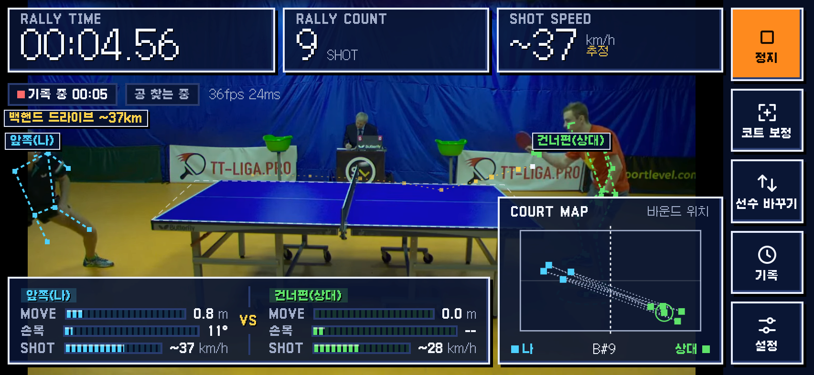

# Table Tennis Vision

A web app for iPhone Safari (or any modern mobile browser) that watches a table tennis game through the phone's rear camera. Put the phone on a tripod next to the table and everything runs on the device: pose skeletons for two players (MediaPipe Pose Landmarker), ball detection and tracking (colour plus motion, no ML), rally time and shot count, an estimated shot speed in km/h, a shot type label, a bounce map, each player's MOVE distance and wrist angle, and a LOCK marker that shows when the ball track is trusted. If you want, finished rallies can be uploaded as highlights to a server you run yourself, with share links nobody can guess. Apart from that upload, the camera stream never leaves the phone.

## Screenshots



*Live HUD computed by the app on the public OpenTTGames test_2 clip.*

| Portrait | History |
|---|---|
|  |  |

Frames from OpenTTGames (https://lab.osai.ai/), CC BY-NC-SA 4.0. The dataset itself isn't included in this repo.

## Quick start (local)

Prerequisites: [bun](https://bun.sh) >= 1.1, `curl`, `unzip`, `sha256sum`.

```bash
bun install
bash scripts/fetch-models.sh   # pose models into public/models/, sha256-checked
bun server.js                  # http://127.0.0.1:8791/vision/
bun test
```

`scripts/fetch-models.sh` downloads `pose_landmarker_lite.task` and `pose_landmarker_full.task` (MediaPipe) plus `rtmpose-s.onnx` and `rtmpose-t.onnx` (RTMPose, extracted from the OpenMMLab zips) and verifies each against a pinned sha256. Run it again any time; files that already match are skipped.

Open **http://localhost:8791/vision/** (keep the trailing slash). Desktop browsers treat `localhost` as a secure context, so the camera works there. No camera handy? Tap **Test with a video file** on the first screen (the UI is in Korean: **영상 파일로 시험**).

Environment variables:

| Variable | Default | What it does |
|---|---|---|
| `PORT` | `8791` | Port for `server.js` (always bound to `127.0.0.1`) |
| `PPV_QA` | unset | `1` also serves the `qa/` pages |
| `PPV_SAVE_DIR` | `~/pingpong-vision-saves` | Where uploaded rallies are stored |
| `PPV_KEY_FILE` | `~/.config/pingpong-vision/upload-key` | Upload key file |
| `PPV_SETUP_FILE` | `~/.config/pingpong-vision/setup-tokens.json` | One-time setup link tokens |

## Serving to a phone over HTTPS

Phones only give camera access to a secure context, so you need HTTPS. The server listens on `127.0.0.1` only, which means you always put a proxy or tunnel in front of it. Pick one:

**(a) Tailscale**

```bash
# reachable only from devices on your tailnet
tailscale serve --bg --set-path=/vision http://127.0.0.1:8791/vision
# or public on the internet
tailscale funnel --bg --set-path=/vision http://127.0.0.1:8791/vision
```

**(b) Caddy with your own domain** (Caddy gets the certificate for you)

```caddy
example.com {
    handle /vision* {
        reverse_proxy 127.0.0.1:8791
    }
}
```

**(c) Cloudflare Tunnel** (no domain needed for a quick test)

```bash
cloudflared tunnel --url http://127.0.0.1:8791
```

Then open `<printed url>/vision/` on the phone.

### start.sh

`start.sh` installs a systemd user unit (`pingpong-vision.service`), waits for `/healthz`, and mounts the app at `/vision` on Tailscale Funnel. It needs `FUNNEL_PORT` set, either in the environment or in `~/.config/pingpong-vision/deploy.env`:

```bash
FUNNEL_PORT=443
PORT=8791
```

Funnel only allows ports 443, 8443 and 10000. `./start.sh --restart` restarts the service without changing the URL.

### Optional: save rallies to your PC

With saving turned on, the phone uploads each finished rally's clip and stats to `save-server.js`, and the history sheet gets a share link for it. On first start the server creates an upload key under `~/.config/pingpong-vision/`. `scripts/make-setup-link.mjs` makes a one-time link that hands the key to a phone. Never commit the key. Details are in [docs/save-to-pc.md](docs/save-to-pc.md).

### Optional: auto-score a separate scoreboard app

`public/js/point.js` judges who won each point from the bounce sequence (double bounce, out, miss), and `public/js/tournament.js` can enter that point into a scoreboard app served at `/` of the same origin, through its own `POST /api/action` with the scoreboard PIN. The PIN is typed once in Settings and stays on that phone; no address or PIN is in the code. A 3 s cancel button undoes a wrong call. The API the scoreboard has to provide, the accuracy on OpenTTGames, and the end-to-end test are in [docs/tournament-link.md](docs/tournament-link.md). Without a scoreboard app the vision app works on its own.

## Usage

1. Mount the phone on a tripod in line with the net, 2 to 3 m from the sideline, 1.5 to 2 m high, looking slightly down so the whole table and both players are in frame. Keep the picture level. If the camera sits at table height, the table top collapses into a line and bounces and speed can't be computed. See [docs/system-design.md](docs/system-design.md) for placement.
2. Open the URL and tap **Start camera** (카메라 시작). Allow camera access.
3. Calibrate the court once (코트 보정) by tapping the four table corners in the order the screen asks: 1 your end line, left corner; 2 your end line, right corner; 3 far end line, right corner; 4 far end line, left corner. Drag a point to fix it, then confirm. Calibration is kept as long as the tripod doesn't move. Until it's done, or when the area inside the four points doesn't look like a table top ("no table"), the app doesn't look for the ball or players. It also pauses while the phone is shaking.
4. The player closest to your end becomes the near player, the other the far player. If they're swapped, tap **Swap players** (선수 바꾸기). For a left-handed player, switch their racket hand to left in Settings; it's used for forehand/backhand.
5. Play. Tap **Stop** when done and open **History** (기록) for each rally's time, shot count, top speed and bounce map.
6. An iPad in landscape or a phone mirrored to a TV switches to a large-screen layout. You can also pick it by hand in Settings (화면: 자동 / 폰 / 큰 화면(TV)).

## Accuracy

Measured on OpenTTGames `test_2` (1080p 120 fps source, 30 s) on a Linux PC, processed at 60 fps. **Not measured on an iPhone.**

| Metric | Ball only (command below) | With pose boxes from a browser run |
|---|---|---|
| Ball recall / precision (within 20 px, on annotated frames) | 85.8% / 96.5% | 85.0% / 94.8% |
| Bounce F1 (28 annotated bounces) | 83.3% | 85.2% |
| Bounce intervals with the right shot count | 15/16 | 15/16 |
| Shot speed, median error vs speeds from annotated ball positions | n/a | 11.4% |

- At 30 fps (dark rooms) with pose boxes: ball 62.6% / 97.6% (83.6% / 97.0% counting trail points), bounce F1 80.7%, shots 15/16. The ball box appears about 0.13 s late because LOCK needs a smooth arc first.
- Browser run (Chromium, 60 fps): both players' skeletons found in 73.8% of frames.
- Empty scenes: 0 balls, shots and bounces on six no-table clips (tripod / gentle shake / strong shake, with and without corner taps). Those clips come from a private home recording and are not included.
- Several bounce "false positives" sit where the annotation skips a bounce that must physically exist; counting those, bounce precision is about 97%.

To reproduce, download `test_2.mp4` and the `test_2.zip` markup from https://lab.osai.ai/datasets/openttgames/data/ into `data/videos/` (gitignored), unzip the markup to `data/videos/test_2/`, then:

```bash
bun qa/ball-offline.mjs --video=data/videos/test_2.mp4 \
  --corners='[{"x":355,"y":634},{"x":557,"y":519},{"x":1339,"y":535},{"x":1486,"y":659}]' \
  --out=/tmp/test_2.offline.json
bun qa/score.mjs /tmp/test_2.offline.json data/videos/test_2 /tmp/test_2.score.json
```

That prints `ball recall=85.8% precision=96.5% ... bounce ... F1=83.3% ... shots: 15/16` (checked from a fresh clone). `ball-offline.mjs` also takes `--srcFps` (default 120), `--fps` (default 60), `--procWidth` (default 640) and `--boxes=<pose dump>` to mask player bodies with pose boxes from `qa/eval-run.mjs --dumpPose=1` (browser run, needs `PPV_QA=1 PORT=8801 bun server.js`).

`bench.html` (on-device pose speed test) needs one 1280x720 still with two players at `public/bench/frame.jpg`, which is not included. Make one from the same clip:

```bash
ffmpeg -ss 0.9 -i data/videos/test_2.mp4 -frames:v 1 -vf scale=1280:720 -q:v 3 public/bench/frame.jpg
```

## Limitations

- **Speed and distance are estimates from one camera.** Ball height is unknown, so positions are projected onto the table centerline and scaled by the table length (2.74 m). Side views work best.
- **The ball detector is colour and motion based**, tuned for a white ball. White clothes or white backgrounds cause misses and false hits, and dark rooms hurt a lot (recall around 57 to 67% on dark clips).
- **Frame rate:** Safari can only request 60 fps and drops to 30 fps in low light, where fast balls can skip a bounce.
- **Shot type is a rule**, not a model: forehand/backhand from which side of the body the wrist is on, drive/smash/lob/push from speed and arc. No spin.
- **Two players only** (near and far). Doubles and passers-by aren't handled.
- **iPhone fps wasn't measured here.** Open `/vision/bench.html` on your phone to check.

## Adapting to another sport (e.g. tennis)

Everything sport-specific lives in a handful of modules. Here's where to look.

| Concern | Where | What to change |
|---|---|---|
| Court geometry | `public/js/geom.js`: `TABLE_LENGTH` (2.74), `TABLE_WIDTH` (1.525), `TABLE_HEIGHT` (0.76), `makeCalibration` | Court size in metres. Tennis players stand on the court plane, so the floor drop by `TABLE_HEIGHT` becomes 0. |
| Duplicated constants | `public/js/ui.js`: `TABLE_L`, `TABLE_W` (bounce map), `MOVE_SCALE_M`, `SHOT_SCALE_KMH` | Bounce map shape and meter scales (60 km/h is far too low for tennis). |
| Player zone | `public/js/players.js`: `ZONE_M`, `plausiblePerson`, `MOVE_*` constants | Players can be well outside a tennis court; widen the zone. |
| Ball appearance | `public/js/ball.js`: `BallDetector`, `BallTracker`, `pathResidual` | Colour, brightness, size and speed gates. A tennis ball is yellow-green and bigger. |
| Scene gates | `public/js/pipeline.js`: `tableUniformity`, `TABLE_MIN_UNIFORM`, `TABLE_CHECK_EVERY`, `SHAKE_*`, `ISSUE_NO_TABLE` | The "is this a uniform table top" check assumes a small single-colour surface. A court has lines and mixed surfaces; loosen or replace it. |
| Bounces, shots, rally end | `public/js/rally.js`: `RallyEngine` | Bounce detection, shot inference, rally timeout, near/far side via `TABLE_LENGTH / 2` (the net). |
| Point winner | `public/js/point.js` (+ `test/point.test.js`, `qa/point-eval.mjs`) | Who lost the point from the bounce order. Rewrite for tennis rules: in/out by court lines, service boxes, one bounce allowed before the return. |
| Shot labels | `public/js/rally.js`: `classifyKind` (speed thresholds 45/35/22 km/h), `strokeSide` | Tennis strokes (serve, volley, slice...) and new thresholds. |
| Calibration UI | `public/js/ui.js`: `CALIB_STEPS`, `CALIB_DONE` | Tap court-line corners instead of table corners. |
| HUD text | `public/js/hud.js` (`drawHud`), `public/js/ui.js`, Korean strings in `pipeline.js` | Labels and messages. |
| Tests | `test/ball.test.js`, `test/rally.test.js`, `test/players.test.js` | Update fixtures and expected values. |
| Offline harness | `qa/ball-offline.mjs`, `qa/score.mjs` (net x defaults to 920 px) | Point at your own annotated clips. |

Checklist:

- [ ] New court dimensions in `geom.js` and `ui.js`
- [ ] Floor offset set to the court plane
- [ ] Ball colour/size/speed gates retuned in `ball.js`
- [ ] Table uniformity check replaced in `pipeline.js`
- [ ] Bounce, rally end and shot labels rewritten in `rally.js`
- [ ] Calibration prompts and HUD strings updated
- [ ] `bun test` green with new fixtures
- [ ] Recall/precision measured with the offline harness on real footage

## Project layout

| Path | Purpose |
|---|---|
| `server.js` | Bun static server on 127.0.0.1, `/healthz`, mounts the save API |
| `save-server.js` | Optional rally upload, share links, upload key and setup tokens |
| `build-id.js` | Build id and shell file list stamped into `sw.js` and `index.html` |
| `start.sh` | systemd user unit plus Tailscale Funnel mount |
| `public/` | The app: `index.html`, `style.css`, `sw.js`, manifest, fonts, icons, `bench.html` |
| `public/js/app.js` | Wiring: camera, video file input, main loop, settings |
| `public/js/pipeline.js` | Per-frame pipeline: table and shake gates, ball, players, rally |
| `public/js/ball.js` | Colour/motion ball detector and tracker |
| `public/js/pose.js` | Pose model loading and inference |
| `public/js/players.js` | Near/far player assignment, MOVE distance, wrist angle |
| `public/js/rally.js` | Rally engine: bounces, shots, speed, shot type |
| `public/js/geom.js` | Homography, calibration, table constants |
| `public/js/hud.js` | Canvas HUD: skeletons, ball trail, LOCK marker |
| `public/js/ui.js` | DOM UI: panels, calibration, history, settings |
| `public/js/recorder.js` | Rally clip recording for upload |
| `public/js/bench.js` | On-device pose speed benchmark |
| `public/js/point.js` | Point winner from the bounce sequence |
| `public/js/tournament.js` | Optional link to a scoreboard app on the same origin |
| `qa/` | Offline and browser harnesses (`ball-offline.mjs`, `score.mjs`, `empty-scene.mjs`, e2e scripts) |
| `test/` | `bun test` unit tests |
| `scripts/` | `fetch-models.sh`, `make-setup-link.mjs`, `scan-public.sh` (leak check of a committed tree, see below), `export-public.sh` |
| `docs/` | `system-design.md`, `contract.md`, `save-to-pc.md`, `ui-guidelines.md` |

## Contributing

Never commit camera recordings, frames, keys or host names. Before pushing, check what is committed (the working tree also holds gitignored models and videos, so scan an archive of `HEAD`):

```bash
R=$(mktemp -d) && git archive HEAD | tar -x -C "$R" && bash scripts/scan-public.sh "$R"; rm -rf "$R"
```

## License

MIT © orientpine, see [LICENSE](LICENSE).

Third-party pieces (details in [THIRD_PARTY_NOTICES.md](THIRD_PARTY_NOTICES.md)):

- Galmuri font, OFL-1.1 (`public/fonts/LICENSE-Galmuri-OFL.txt`)
- MediaPipe tasks-vision and pose models, Apache-2.0
- onnxruntime-web, MIT
- RTMPose models (OpenMMLab), Apache-2.0

OpenTTGames data isn't included (CC BY-NC-SA 4.0).

## 한국어 요약

- **무엇**: 아이폰 Safari(최신 모바일 브라우저면 됨)에서 도는 탁구 분석 웹앱입니다. 탁구대 옆 삼각대에 폰을 세우면 두 선수 뼈대, 공 추적(색·움직임 기반, ML 없음), 랠리 시간·샷 수, 속도 추정(km/h), 샷 종류, 바운드 지도, 선수별 이동 거리(MOVE)·손목 각도, LOCK 표시를 폰 안에서 계산합니다.
- **개인정보**: 카메라 영상은 폰 밖으로 나가지 않습니다. 단, 직접 켠 경우에만 랠리 하이라이트를 내 서버로 올리고 추측할 수 없는 공유 링크를 만듭니다.
- **로컬 실행**: bun 1.1 이상, curl, unzip, sha256sum이 필요합니다. `bun install`, `bash scripts/fetch-models.sh`, `bun server.js` 순서로 실행하고 http://localhost:8791/vision/ 을 엽니다. 카메라가 없으면 첫 화면의 **영상 파일로 시험**을 씁니다. 테스트는 `bun test`.
- **환경 변수**: `PORT`(기본 8791), `PPV_QA=1`, `PPV_SAVE_DIR`, `PPV_KEY_FILE`, `PPV_SETUP_FILE`.
- **폰에서 쓰기**: 카메라는 HTTPS가 필요합니다. 서버는 127.0.0.1에만 붙으므로 Tailscale serve/funnel, Caddy, Cloudflare Tunnel 중 하나를 앞에 둡니다. `start.sh`는 systemd 유저 서비스와 Funnel을 설정하며 `FUNNEL_PORT`가 꼭 있어야 합니다.
- **PC 저장(선택)**: 첫 실행 때 `~/.config/pingpong-vision/`에 업로드 열쇠가 생깁니다. 절대 커밋하지 마세요. 자세한 내용은 docs/save-to-pc.md.
- **쓰는 법**: 네트 연장선 옆, 옆줄에서 2~3 m, 높이 1.5~2 m에서 살짝 내려다보게 둡니다. 코트 보정은 내 쪽 왼쪽, 내 쪽 오른쪽, 건너편 오른쪽, 건너편 왼쪽 모서리 순서입니다. 선수가 바뀌면 **선수 바꾸기**, 왼손잡이는 설정에서 왼손으로. 끝나면 **정지** 후 **기록**. 아이패드 가로나 TV 미러링은 큰 화면 배치가 됩니다.
- **정확도**(OpenTTGames test_2, 리눅스 PC에서 60 fps로 처리, 아이폰 아님): 공 재현율 85.0%/정밀도 94.8%, 바운드 F1 85.2%, 샷 15/16, 속도 중앙 오차 11.4%(자세 상자 포함). README 명령(공만)으로는 85.8%/96.5%, 바운드 F1 83.3%, 샷 15/16. 30 fps에서는 공 62.6%/97.6%, 바운드 F1 80.7%, 샷 15/16. 두 선수 뼈대 검출 73.8%(Chromium 60 fps). 탁구대 없는 영상 6개에서 오탐 0.
- **한계**: 속도·거리는 카메라 한 대 추정치입니다. 흰 공 기준이라 흰 옷·흰 배경·어두운 곳에 약합니다(어두운 영상 재현율 약 57~67%). 어두우면 30 fps로 떨어집니다. 샷 종류는 규칙 기반이고 스핀은 모릅니다. 선수는 두 명만. 아이폰 fps는 폰에서 `/vision/bench.html`로 직접 재세요.
- **대회 점수판 연동(선택)**: `point.js`가 바운드 순서로 포인트 승패를 판정하고, `tournament.js`가 같은 주소 `/`의 점수판 앱에 PIN으로 점수를 넣습니다. PIN은 설정에서 한 번 넣고 그 폰에만 남습니다. 자세한 것은 docs/tournament-link.md.
- **다른 종목(테니스)으로 바꾸기**: 위 "Adapting to another sport" 표를 보세요. 코트 크기(`geom.js`, `ui.js`), 공 판정(`ball.js`), 탁구대 균일도 검사(`pipeline.js`), 바운드·샷 규칙(`rally.js`), 보정 안내 문구(`ui.js`), 테스트와 오프라인 측정 도구를 고치면 됩니다.
- **라이선스**: MIT © orientpine. Galmuri 폰트 OFL-1.1, MediaPipe·RTMPose 모델 Apache-2.0, onnxruntime-web MIT. OpenTTGames 데이터는 포함하지 않습니다(CC BY-NC-SA 4.0).
