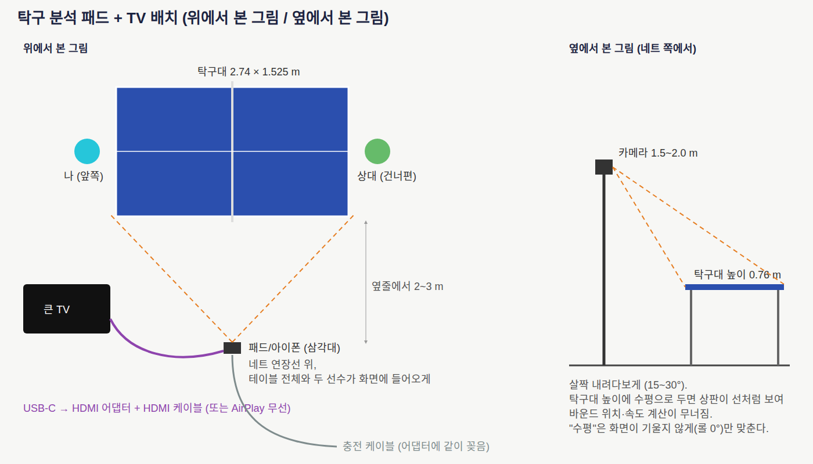

# 별도 시스템 구성안: 카메라 패드 + 큰 TV

구성 목표: 카메라 있는 패드를 탁구대 옆에 두고 찍고, 큰 TV로 구경하는 사람도 같이 보는 구성. 공 추적이 실시간으로 잘 되어야 하고, 자세 추정은 최신 알고리즘이면서 모바일에서 돌아야 한다.

결론 먼저:
- 같은 웹앱을 그대로 쓴다. 아이폰이든 아이패드든 Safari에서 같은 주소를 열면 된다. 화면이 넓은 가로 화면이면 자동으로 "큰 화면(TV)" 배치로 바뀐다(설정에서 직접 고를 수도 있음).
- TV는 패드 화면을 그대로 미러링한다. 지연이 가장 적고 확실한 건 유선(USB-C → HDMI)이고, 선이 싫으면 Apple TV로 AirPlay(약 0.1초 지연).
- 카메라는 탁구대 "높이에 수평"이 아니라, 네트 연장선 옆 1.5~2.0 m 높이에서 살짝 내려다보게 둔다. "수평"은 화면이 기울지 않게(좌우 기울기 0°) 맞추는 뜻으로만 지킨다.

## 1. 카메라 배치와 그 이유

| 항목 | 권장 | 근거 |
|---|---|---|
| 위치 | 네트 연장선 위, 옆줄에서 2~3 m | 공개 데이터셋 OpenTTGames/TTNet이 네트 쪽 옆에서 찍은 고정 영상이다. 두 선수와 테이블 전체가 한 화면에 들어오고, 공이 화면을 가로로 지나가 좌우 방향 전환(타구)이 잘 보인다. https://lab.osai.ai/ , https://github.com/moamal01/table_tennis_data |
| 높이 | 1.5~2.0 m, 15~30° 내려다봄 | 테이블 높이(0.76 m)에 카메라를 맞추면 상판이 선처럼 납작해져서, 네 모서리 보정(호모그래피)으로 바운드 위치를 계산할 수 없다. 높이 올라갈수록 상판이 넓게 보여 바운드 위치 오차가 줄어든다. 상용 예: Spinsight는 삼각대 170 cm, 테이블에서 100 cm. https://spinsight.com/app/experimental/help/ |
| 기울기 | 좌우 기울기 0° (화면 수평) | 앱은 공의 위아래 움직임으로 바운드를 잡는다. 화면이 기울면 "아래"가 틀어진다. |
| 조명 | 밝고 고르게 | 빠른 공은 셔터 시간 동안 번진다. 100 km/h 공은 1/1000초 셔터에서 2.8 cm 번진다. 밝을수록 셔터가 짧아진다. |

## 2. 실시간 목표와 카메라 fps

공이 100 km/h(27.8 m/s)일 때 한 프레임 사이 이동 거리:

| fps | 프레임당 이동 |
|---:|---:|
| 30 | 93 cm |
| 60 | 46 cm |
| 120 | 23 cm |
| 240 | 12 cm |

- 30 fps면 빠른 공은 테이블을 2~3 프레임 만에 지나가서 바운드·타구 순간을 놓친다. 60 fps가 웹에서 현실적인 최소값이다.
- Safari 웹 카메라(getUserMedia)는 60 fps를 "요청"만 할 수 있고(기기·조명에 따라 30으로 떨어질 수 있음), 120/240 fps는 네이티브 앱(AVFoundation)에서만 쓸 수 있다고 본다(웹에서 120을 받았다는 근거는 찾지 못함). 앱은 실제로 받은 fps를 화면에 표시한다.
- 목표: 화면 처리 30 fps 이상(카메라 60 fps 요청), 공 인식 처리 1프레임 5 ms 이내, 공 인식률(주석 프레임 기준)과 바운드 F1은 README의 측정값 참고.

## 3. 자세 추정 알고리즘 비교 (2025~2026)

| 모델 | 정확도(COCO AP) | 여러 명 | 라이선스 | 폰 브라우저에서 | 판단 |
|---|---|---|---|---|---|
| MediaPipe Pose Landmarker Lite/Full (tasks-vision 1.2.0) | 공개 COCO AP 없음, 33점 + 3D | numPoses로 2명 | Apache-2.0 | 공식 웹 런타임(WASM+WebGL), 모델 5.8 MB | **채택**. Safari에서 바로 도는 유일한 공식 경로 |
| RTMPose-t/s (MMPose) | 68.2 / 71.6 | 사람 검출기 따로 필요 | Apache-2.0 | ONNX Runtime Web(WASM/WebGL) 데모 있음 | 업그레이드 후보. 검출기+자세 두 모델이라 폰에서 30fps 근거 없음 |
| RTMO-s | 68.6, 30.7 GFLOPs | 한 번에 여러 명 | Apache-2.0 | 640×640 입력이 폰 웹엔 무거움 | 보류 |
| YOLO26n-pose / YOLO11n-pose | 57.2 / 50.0 | 한 번에 여러 명 | AGPL-3.0 | ONNX 내보내기 가능, Safari 실측 없음 | 라이선스 부담 + 정확도 낮음 |
| ViTPose++-S, Sapiens | 75.8 / 79+ | 검출기 필요 | Sapiens는 비상업 | 폰 웹 실행 경로 없음 | 서버급, 제외 |
| Apple Vision 2D/3D body pose | 비공개 | 2D 여러 명, 3D는 1명 | 애플 API | 네이티브 앱 전용 | 네이티브로 갈 때 1순위 |

출처: MediaPipe https://developers.google.com/edge/mediapipe/solutions/vision/pose_landmarker/web_js , RTMPose/RTMO https://mmpose.readthedocs.io/en/latest/model_zoo/body_2d_keypoint.html , YOLO26 https://github.com/ultralytics/ultralytics , ORT 웹 Safari 지원표 https://onnxruntime.ai/docs/tutorials/web/ep-webgpu.html , Apple Vision https://developer.apple.com/documentation/vision/vndetecthumanbodyposerequest

ONNX Runtime Web의 WebGPU는 아직 iOS Safari를 지원 목록에 올리지 않았다(Safari 26 자체는 WebGPU를 켰지만). 그래서 지금은 MediaPipe(WebGL/WASM)가 가장 확실하다.

### 실측 (ARM 리눅스 PC 브라우저, 2026-10-29) — 폰에서 재는 페이지: `/vision/bench.html`

같은 테스트 장면(1280×720, 선수 2명)에서 워밍업 5회 후 40회 평균. ARM 리눅스 PC 브라우저 값이라 **아이폰 실측이 아니다**. 앱 서버의 `/vision/bench.html`을 모바일 기기에서 열면 같은 표가 기기 값으로 나온다(카메라 불필요, 결과 복사 버튼 있음).

| 모델 | 실행 방식 | WebKit(사파리 엔진, iPhone 15 화면) | Chromium(소프트웨어 GPU) |
|---|---|---:|---:|
| MediaPipe Pose Lite (2명까지 설정, 이 테스트 장면에서는 1명만 잡힘) | GPU(WebGL) | 10.0 ms (100 fps) | 217 ms |
| MediaPipe Pose Full | GPU(WebGL) | 10.2 ms | 276 ms |
| RTMPose-s ×2명 (사람 검출 제외) | WASM | 55.8 ms (18 fps) | 58.6 ms |
| RTMPose-t ×2명 (사람 검출 제외) | WASM | 31.8 ms (31 fps) | 33.2 ms |
| RTMPose (WebGL / WebGPU) | — | 실패: WebGL은 Clip 연산 미지원, WebGPU 없음 | 실패 |

원본 측정 JSON과 확인 캡처(키포인트가 선수 위에 찍힌 그림)는 공개 저장소에 넣지 않았다. 폰에서 `/vision/bench.html`을 열면 같은 표를 다시 만든다.

주의: bench 장면(1280×720 한 장)에서 MediaPipe는 오른쪽 선수만 잡았다. 실제 영상 전체에서는 두 선수 모두 잡힌 프레임이 73.8%(Chromium)·45.1%(WebKit)다(정확도 측정 표).

### 실측 (오너 아이폰, iOS 18.7 사파리, 2026-10-29) — `/vision/bench.html`

| 모델 | 실행 방식 | 평균 | p90 | fps |
|---|---|---:|---:|---:|
| MediaPipe Pose Lite (2명) | GPU | 27.5 ms | 37 ms | 36.4 |
| MediaPipe Pose Full (2명) | GPU 실패 → CPU | 64 ms | — | 15.6 |
| RTMPose-s ×2 | WASM | 실패: "both async and sync fetching of the wasm failed" | — | — |
| RTMPose | WebGL | 캡처 시점에 Loading | — | — |

- Full이 CPU로 떨어지는 건 `public/js/pose.js`의 되돌림 경로다: GPU 델리게이트로 모델을 만들다 실패하면 CPU로 다시 만든다. 아이폰에서 Full의 GPU 그래프를 못 만든다는 뜻이고, CPU 15.6 fps는 실시간이 안 된다. 그래서 **Lite를 유지**한다.
- RTMPose WASM 실패는 서버 탓이 아니다: 공개 주소에서 `vendor/ort/ort-wasm-simd-threaded.jsep.wasm`(29.5 MB)·`...threaded.wasm`(14.8 MB)이 모두 200 `application/wasm`으로 나가고, CSP에 `script-src 'self' 'wasm-unsafe-eval'`와 `worker-src 'self' blob:`이 있다. 남은 설명은 아이폰 사파리가 29.5 MB JSEP 빌드를 받아 컴파일하지 못하는 것(메모리)이며, 기기에서 확인하지는 못했다.
- 앱이 실제로 내는 fps(공+자세 동시)는 bench가 아니라 사용 중 화면의 fps 표시로 받는다.

판단: 사파리 엔진에서 GPU로 도는 MediaPipe가 RTMPose(WASM, 사람 검출기 별도 필요)보다 5배 이상 빠르다. 공 추적(1프레임 약 1 ms)과 같이 돌려도 30 fps 여유가 있어 MediaPipe Lite를 쓴다. RTMPose는 정확도(COCO AP 68~72)는 높지만 웹에서 GPU로 못 돌아 지금은 폰 실시간에 불리하다.

## 4. 웹으로 부족할 때 네이티브 앱이 필요한 이유와 준비물

네이티브(iOS 앱)가 필요한 경우: 120/240 fps 카메라, 셔터 속도 직접 제어, Apple Vision/Core ML 가속, 화면을 끈 채 장시간 녹화.
필요한 것: Mac(Xcode), Apple Developer Program(연 99달러, 원화 금액 미확인), 사용자 기기에 설치(TestFlight 또는 개발자 설치). 리눅스 PC로는 빌드할 수 없다.

## 5. 살 하드웨어 목록 (2026-10-29 기준 대략 가격)

| 품목 | 추천 | 대략 가격 | 대안 |
|---|---|---|---|
| 카메라+화면 | iPad (A16) 128GB Wi-Fi | 749,000원 (다나와 최저 약 672,000원) | 지금 쓰는 아이폰(0원), iPad Air M4 949,000원(연산 여유) |
| 거치대 | 180 cm 태블릿 삼각대(클램프형) | 약 37,500원 (쿠팡) | 바닥 스탠드형, 무게추 필수 |
| TV 연결(유선, 권장) | Apple USB-C Digital AV Multiport 어댑터 + HDMI 케이블 5 m | 95,000원 + 약 15,000~55,000원 | |
| TV 연결(무선) | Apple TV 4K (AirPlay 미러링) | 359,000원(이전 세대) / 449,000원(신형, 11/13 출시) | AirPlay 지원 스마트 TV면 0원 |
| 전원 | USB-C 충전기 + 긴 케이블(어댑터에 같이 꽂음) | 약 30,000원(미확인) | |

출처: https://www.apple.com/kr/shop/product/mw5m3kh/a/ , https://prod.danawa.com/list/?cate=122579 , https://www.coupang.com/np/categories/497274 , https://www.apple.com/kr/newsroom/2026/10/apple-unveils-the-new-apple-tv-4k/

## 6. TV로 같이 보기

- 유선: 어댑터를 패드에 꽂고 HDMI로 TV 연결 → 패드 화면 그대로 TV에 나온다(미러링). 충전도 같이 된다. 지연이 거의 없다.
- 무선: 제어 센터 > 화면 미러링 > Apple TV 선택. 독립 측정으로 약 85~95 ms 지연.
- Chromecast는 iOS 화면 미러링을 기본 지원하지 않는다.
- Safari는 TV에 "다른 화면"을 띄우지 못하고 미러링만 한다. 그래서 앱의 "큰 화면" 배치가 16:9 TV에 맞게 글자를 키우고 영상·코트 지도를 크게 보여 준다.
